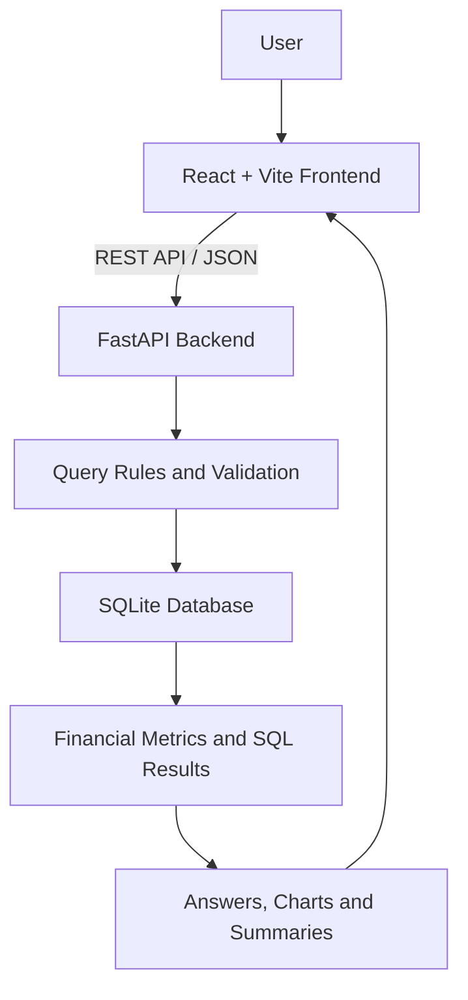

# WealthFlow Query Console

### Conversational Analytics for Financial Operations

<p align="center">
  <strong>Turn financial operations questions into actionable data insights.</strong>
</p>

<p align="center">
  <a href="https://github.com/dinesh175-ai/Wealth-Flow">
    
  </a>
  
  
  
  
</p>

<p align="center">
  <a href="#-overview">Overview</a> •
  <a href="#-features">Features</a> •
  <a href="#-architecture">Architecture</a> •
  <a href="#-quick-start">Quick Start</a> •
  <a href="#-api-reference">API</a> •
  <a href="#-roadmap">Roadmap</a>
</p>

---

## 📌 Overview

**WealthFlow Query Console** is a full-stack financial analytics application designed to make reconciliation and financial operations data easier to explore.

Instead of manually writing SQL for every question, users can submit natural-language questions through a conversational interface. The backend processes supported questions, queries financial data, and returns analytical results with SQL and visual summaries where available.

### 🎯 Problem Statement

Financial operations datasets can contain thousands of reconciliation records, aging indicators, financial amounts, and team-level metrics. Analyzing this information manually can take time and requires SQL knowledge.

### 💡 Solution

WealthFlow provides a conversational interface connected to a Python backend and SQLite database, allowing users to explore supported financial metrics through simple questions.

## 🚀 Features

| Feature | Description |
|---|---|
| 💬 Natural-language queries | Ask supported financial questions in plain English |
| 📊 Financial analytics | Analyze reconciliation breaks, aging, and financial amounts |
| 🧮 SQL transparency | Inspect the SQL returned for supported queries |
| 📈 Visual summaries | Display charts and result summaries where available |
| 🖥️ Interactive frontend | React-based conversational user interface |
| ⚙️ REST API | Connect frontend requests to FastAPI endpoints |
| 🗄️ SQLite integration | Query structured financial operations data |
| 🕘 History interface | Access the query history view |
| 🔐 Security foundation | Design analytical access around read-only queries and backend validation |

> **Note:** The history interface does not guarantee persistent history. Persistence depends on the backend implementation. Access controls and security features must be verified against the actual implementation before being considered production-ready.

## 🧪 Example Questions

Try these questions in the application:

- How many reconciliation breaks are there?
- How many aged breaks are there?
- What is the total break amount in USD?
- Show the breakdown of breaks by team.
- Which teams have the highest number of aged breaks?
- What is the distribution of reconciliation breaks?

The supported questions depend on the query rules and the fields available in the dataset.

<details>
<summary><strong>📊 View dataset snapshot</strong></summary>

The development dataset has previously reported the following statistics:

| Metric | Value |
|---|---:|
| Total records | 134,464 |
| Columns | 35 |
| Total reconciliation breaks | 134,464 |
| Aged breaks | 28,859 |
| Aged break percentage | 21.46% |
| Total break amount | $6,115,381,894.13 |

These are dataset snapshot values, not live market data. Recalculate them when the underlying dataset changes.

</details>

## 🏗️ Architecture



### 🔄 How It Works

1. The user submits a financial question.
2. The React frontend sends a request to the backend.
3. The backend processes the question using supported query rules.
4. The appropriate read-only SQL query is executed against SQLite.
5. The backend returns the result and supporting information.
6. The frontend displays the answer and any available charts or SQL.

## 🧰 Technology Stack

| Technology | Purpose |
|---|---|
| React | Frontend user interface |
| Vite | Frontend development and build tooling |
| JavaScript | Frontend application logic |
| Python | Backend logic and data processing |
| FastAPI | REST API framework |
| Pandas | Tabular data processing |
| SQLite | Relational data storage |
| SQL | Financial analytics queries |
| Git and GitHub | Source control |
| Render | Backend hosting |
| Vercel | Frontend hosting |

## 📂 Project Structure

The exact filenames may vary by version. The repository's actual files are the source of truth.

```text
Wealth-Flow/
├── backend/
│   ├── app/                  # If the backend uses a Python package
│   ├── data/                 # Dataset and database files
│   └── requirements.txt
├── frontend/
│   ├── src/
│   │   ├── App.jsx           # Main application interface
│   │   ├── main.jsx          # React entry point
│   │   └── styles.css        # If present
│   ├── index.html
│   └── package.json
└── README.md
```

## ⚡ Quick Start

### Prerequisites

- Git
- Python compatible with the backend dependencies
- Node.js and npm

### 1. Clone the repository

```bash
git clone https://github.com/dinesh175-ai/Wealth-Flow.git
cd Wealth-Flow
```

### 2. Start the backend

Open PowerShell in the project root:

```powershell
cd backend
python -m venv .venv
.\.venv\Scripts\python.exe -m pip install -r requirements.txt
```

Start the server using the entry point that exists in your repository.

If the entry point is `backend/app/main.py` and it defines the FastAPI application as `app`, run:

```powershell
.\.venv\Scripts\python.exe -m uvicorn app.main:app --reload --host 127.0.0.1 --port 8000
```

If your project instead uses `backend/main.py`, use `main:app`.

Keep the backend terminal running.

### 3. Start the frontend

Open a second PowerShell terminal and navigate to the frontend directory:

```powershell
cd path\to\Wealth-Flow\frontend
npm install
npm run dev
```

Replace `path\to\Wealth-Flow` with your actual project path.

Open the local address printed by Vite, usually:

```text
http://localhost:5173
```

Make sure the frontend API base URL points to your local FastAPI server during local development.

<details>
<summary><strong>🛠️ Build the frontend for deployment</strong></summary>

Run from the repository root:

```powershell
npm.cmd --prefix frontend run build
```

The production build should complete without errors before deployment.

</details>

## 🌐 Deployment

The project has been configured around separate frontend and backend deployments.

| Component | Platform |
|---|---|
| Source code | [GitHub](https://github.com/dinesh175-ai/Wealth-Flow) |
| Backend | [Render](https://wealthflow-query-console.onrender.com) |
| Frontend | Vercel |

Deployment checklist:

- Set the frontend API base URL to the deployed backend.
- Configure backend CORS to allow the deployed frontend origin.
- Confirm that the required dataset is available to the backend.
- Check the hosting logs if a request fails.
- Verify the deployed frontend and backend independently.

The frontend's Vercel project URL should be added here once confirmed.

## 🔌 API Reference

The backend has used the following endpoints in the application:

| Method | Endpoint | Purpose |
|---|---|---|
| `POST` | `/api/ask` | Submit an analytical question |
| `GET` | `/api/history` | Retrieve available query history |
| `GET` | `/api/schema` | Inspect dataset schema, if implemented |

### Example request

```http
POST /api/ask
Content-Type: application/json
```

```json
{
  "question": "How many aged breaks are there?",
  "role": "analyst"
}
```

Example response shape:

```json
{
  "answer": "There are 28,859 aged breaks.",
  "sql": "SELECT ..."
}
```

The SQL above is abbreviated for documentation. Actual response fields may differ by backend version.

<details>
<summary><strong>🧪 Test the deployed API</strong></summary>

In PowerShell, run:

```powershell
$body = @{
    question = "How many aged breaks are there?"
    role = "analyst"
} | ConvertTo-Json

Invoke-RestMethod `
    -Uri "https://wealthflow-query-console.onrender.com/api/ask" `
    -Method Post `
    -ContentType "application/json" `
    -Body $body
```

If the request fails, check the backend deployment logs, route configuration, and CORS settings.

</details>

## 🔐 Security Considerations

- Never commit API keys, passwords, or private environment files.
- Validate all user questions and SQL before execution.
- Restrict analytical queries to permitted read-only operations.
- Enforce access permissions on the backend.
- Avoid publishing confidential financial records in a public repository.
- Treat demo dataset statistics as illustrative, not as verified live financial information.

## 🗺️ Roadmap

- [x] React frontend and FastAPI integration
- [x] Financial query interface
- [x] SQL and result presentation for supported questions
- [x] GitHub source control
- [ ] Persistent query history verification
- [ ] Automated backend and frontend tests
- [ ] Expanded query coverage
- [ ] Downloadable reports and CSV exports
- [ ] Stronger role-based access and audit logging
- [ ] Improved data validation and operational monitoring

Roadmap items should be marked complete only after they have been implemented and tested.

## 👨‍💻 Author

**Dinesh Reddy**  
B.Tech — Computer Science Engineering (AI & ML)

- GitHub: [@dinesh175-ai](https://github.com/dinesh175-ai)
- Project: [Wealth-Flow](https://github.com/dinesh175-ai/Wealth-Flow)

## 🤝 Contributing

Contributions and suggestions are welcome.

1. Fork the repository.
2. Create a feature branch.
3. Make and test your changes.
4. Submit a pull request describing the improvement.

## 📄 License

A license has not been specified in this README. Add an appropriate `LICENSE` file before describing the project as open source under a particular license.

---

<p align="center">
  <strong>WealthFlow Query Console</strong><br>
  Making financial operations data easier to query, understand, and analyze.
</p>
